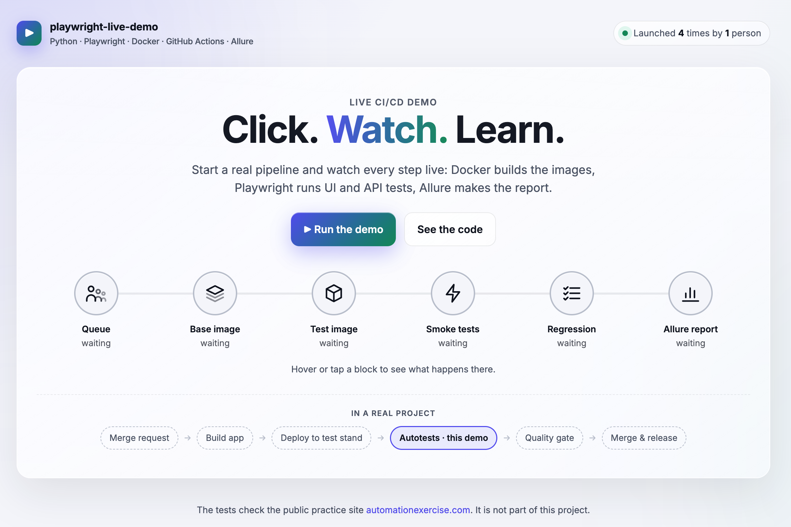

# playwright-live-demo

Click a link and watch a real CI/CD pipeline: Docker build, Python + Playwright tests, Allure report — live, step by step.

## Project goal

This project shows where UI and API autotests run in a CI/CD pipeline.
You can start the pipeline yourself: click **Run the demo**, then **Create**.
With **Watch it live, step by step** you see what happens right now, in real time.

The tests check the public practice site [automationexercise.com](https://automationexercise.com).
This site is not part of this project.

## Run the demo

Open the page, click **Run the demo**, then **Create**, and watch the pipeline live:

```text
https://luufqa.github.io/playwright-live-demo/
```

[](https://luufqa.github.io/playwright-live-demo/)

## What happens

In a real project, autotests start after the app is deployed to a test stand.
Here the test stand is the public site automationexercise.com.

1. You click **Run the demo** and **Create**. GitHub Actions takes your run: up to 3 runs go at the same time, other people wait in a queue.
2. Docker downloads `debian:trixie-slim` from Docker Hub and installs Python 3.13 (stage `base`).
3. Docker installs pytest, Playwright, Chromium and Allure and copies the tests (stage `tests`).
4. **Smoke tests** run first: the most important checks. A fixture creates a test user with the API before the tests and deletes it after them. If one smoke test fails, the pipeline stops.
5. If all smoke tests pass, the **regression** runs: all other API and UI tests, again with a new test user.
6. Every test is **passed**, **failed** or **skipped** (a test can be skipped on purpose with the `skip` marker).
7. Allure makes a report with steps, API responses and screenshots of failed UI tests. GitHub Pages publishes it.
8. **Quality gate**: the team reads the report and decides: fix the bugs now, or accept the risk and release.

## Tests

Expected result: **13 passed, 1 failed, 1 skipped.**

- The failed test is real: the site answers `200` to an unsupported `POST` request, but REST says it must be `405`.
- The skipped test shows how to skip a test on purpose: real payments are not allowed in the demo.

## Project structure

```text
├── api/        # API client for the site
├── data/       # test data
├── files/      # files for upload tests
├── locators/   # locators that are hard to find by role or text
├── pages/      # Page Object Model: one class for each page
├── tests/      # API and UI tests
├── showcase/   # only for this demo: live progress in the issue (not needed in a usual test project)
├── conftest.py # fixtures: API client, test user, screenshot on failure
├── pytest.ini  # site URL, browser, markers
└── Dockerfile  # two stages: base → tests
```

## License

[MIT](./LICENSE)
